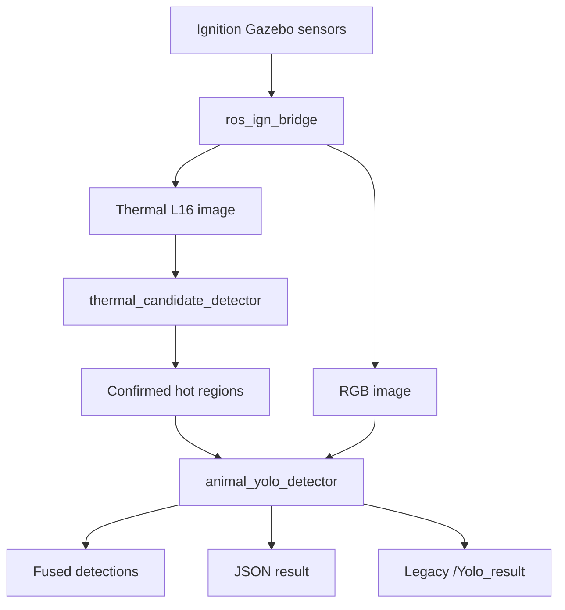

# Perception System: Thermal Detection and RGB YOLO

This document explains the perception system in `41068_ignition_bringup`. It covers:

1. How to run perception.
2. How the system works.
3. Which ROS 2 nodes publish and subscribe to each topic, and how they connect.

## 1. System purpose

The perception pipeline combines two sensors on the Husky robot:

- The **thermal camera** finds hot regions but cannot identify the object.
- The **RGB camera and YOLO** classify the object as `kangaroo`, `boar`, or `deer`.
- The final classification policy is:
  - `kangaroo` → `native`
  - `boar` or `deer` → `exotic`
  - No suitable YOLO match → `unknown`

In the full pipeline, YOLO does not run continuously. It waits until the thermal detector confirms a hot region. This reduces unnecessary inference and ensures that YOLO classifies the object associated with the heat source.

## 2. How to run perception

### 2.1 Requirements

This guide assumes that you are using:

- Ubuntu with ROS 2 Humble
- Ignition Gazebo Fortress
- A colcon workspace at `~/41068_ws`
- This package inside `~/41068_ws/src/`
- The trained model at `weights/my_model.pt`

Install the required dependencies:

```bash
sudo apt update
sudo apt install python3-opencv ros-humble-cv-bridge \
  ros-humble-vision-msgs ros-humble-std-srvs
python3 -m pip install ultralytics
```

Build and source the workspace:

```bash
source /opt/ros/humble/setup.bash
cd ~/41068_ws
colcon build --symlink-install
source install/setup.bash
export ROS_LOCALHOST_ONLY=1
```

Build and source the workspace again after changing a launch file, configuration file, or Python node.

### 2.2 Run the complete perception pipeline

Open **Terminal 1** and start the Husky simulation in the world containing animals and heat sources:

```bash
source /opt/ros/humble/setup.bash
source ~/41068_ws/install/setup.bash
export ROS_LOCALHOST_ONLY=1

ros2 launch 41068_ignition_bringup 41068_ignition_husky.launch.py \
  world:=large_demo rviz:=true
```

Open **Terminal 2** and start the thermal detector and YOLO detector:

```bash
source /opt/ros/humble/setup.bash
source ~/41068_ws/install/setup.bash
export ROS_LOCALHOST_ONLY=1

ros2 launch 41068_ignition_bringup 41068_thermal_yolo.launch.py \
  namespace:=husky1
```

This launch file starts two perception nodes:

1. `/husky1/thermal_candidate_detector`
2. `/husky1/animal_yolo_detector`

Their default parameters come from `config/perception_thermal_yolo.yaml`. The default model is `weights/my_model.pt`.

### 2.3 Override parameters from the launch command

The following example uses a 310 K thermal threshold, a YOLO confidence threshold of 0.60, and requires four matching votes from six RGB frames:

```bash
ros2 launch 41068_ignition_bringup 41068_thermal_yolo.launch.py \
  namespace:=husky1 \
  hot_threshold_k:=310.0 \
  yolo_confidence:=0.60 \
  verification_frames:=6 \
  verification_min_votes:=4
```

| Launch argument | Default | Purpose |
|---|---:|---|
| `namespace` | `husky1` | Robot namespace used by the perception nodes and topics |
| `model_path` | `weights/my_model.pt` | Path to the trained YOLO weights |
| `hot_threshold_k` | `315.0` | Minimum temperature for a hot pixel, in kelvin |
| `min_hot_area_px` | `30` | Minimum connected hot-region area, in thermal pixels |
| `yolo_confidence` | `0.50` | Minimum YOLO confidence |
| `verification_frames` | `5` | Number of fresh RGB frames in one verification window |
| `verification_min_votes` | `3` | Matching class votes required for acceptance |
| `thermal_retrigger_sec` | `0.0` | `0`: classify once until heat disappears; positive value: repeat periodically |
| `device` | Empty | Ultralytics device override, such as `cpu` or GPU `0` |

### 2.4 Run RGB YOLO without thermal gating

Use this mode to test the YOLO model independently. YOLO runs continuously over the complete RGB image:

```bash
ros2 launch 41068_ignition_bringup 41068_yolo.launch.py \
  namespace:=husky1 continuous:=True
```

This is not the complete thermal–RGB fusion pipeline.

### 2.5 Check that the system is running

```bash
ros2 node list
ros2 topic list | grep husky1
ros2 topic hz /husky1/thermal/image_raw
ros2 topic hz /husky1/camera/image
ros2 topic echo /husky1/perception/thermal/candidate_active
ros2 topic echo /husky1/perception/thermal_yolo/result
```

To view the debug images:

```bash
ros2 run rqt_image_view rqt_image_view
```

Select one of these topics:

- `/husky1/perception/thermal/annotated_image`
- `/husky1/perception/rgb/annotated_image`
- `/husky1/perception/rgb/confirmation_image`

To request immediate classification of the newest RGB frame:

```bash
ros2 service call /husky1/perception/rgb/classify_now \
  std_srvs/srv/Trigger '{}'
```

## 3. How the perception system works

### 3.1 Data-flow overview



### 3.2 Step 1 — Gazebo produces camera data

The Husky URDF configures:

- RGB image: **720 × 480**, approximately **120° horizontal FOV**, at **3 Hz**.
- Thermal image: **320 × 240**, **L16** format, approximately **60° horizontal FOV**, at **10 Hz** by default.

`ros_ign_bridge` converts the Gazebo Transport topics into ROS 2 topics:

- Gazebo `/model/husky1/camera/image` → ROS `/husky1/camera/image`
- Gazebo `/model/husky1/thermal_camera/image` → ROS `/husky1/thermal/image_raw`

### 3.3 Step 2 — The thermal node finds hot regions

`thermal_candidate_detector` receives the L16 thermal image. Under the current configuration, one raw count represents `0.01 K`:

```text
temperature_K = raw_value × kelvin_per_count
```

The node then:

1. Creates a binary mask containing pixels at or above `hot_threshold_k`.
2. Uses morphological opening and closing to remove small noise and repair small gaps.
3. Uses connected components to separate hot regions.
4. Rejects regions smaller than `min_hot_area_px`.
5. Sorts the regions by area and keeps at most `max_regions`.
6. Publishes confirmed detections only after heat is present for the required `persistence_frames`.

Each detection contains a thermal bounding box, the label `heat_source`, and a score derived from the maximum region temperature. The node also publishes normalized and annotated images, an active-candidate flag, and the maximum frame temperature.

Implementation note: the current `persistence_frames` counter confirms that the frame contains at least one hot region; it does not independently track each object. Thermal detection IDs are empty, so the YOLO node generates fallback IDs such as `thermal_1` and `thermal_2` based on message order.

### 3.4 Step 3 — Thermal detections trigger YOLO

The full pipeline uses `thermal_gate_enabled: true` and `continuous: false`.

- A change from no thermal detection to one or more detections starts a verification window.
- By default, the same continuously visible heat source does not immediately trigger another window because `thermal_retrigger_sec` is `0.0`.
- An empty thermal detection array resets the gate. A later heat event can trigger YOLO again.
- Setting `thermal_retrigger_sec` above zero allows periodic reclassification while heat remains visible.

### 3.5 Step 4 — Project the thermal ROI into the RGB image

The RGB and thermal images have different fields of view and resolutions. Therefore, the software must not simply resize thermal pixel coordinates to RGB coordinates.

`perception_common.py` applies pinhole-camera geometry. It converts the thermal bounding-box boundaries into view angles and projects them into the RGB image. With the default configuration, the 60° thermal view occupies the central area of the wider 120° RGB view.

The projected region is expanded by `thermal_roi_margin: 1.5`. The X and Y offset parameters can correct small camera alignment or parallax errors.

### 3.6 Step 5 — Associate a YOLO box with each thermal region

YOLO runs on an RGB frame and creates object bounding boxes. A YOLO box is compatible with a projected thermal ROI when at least one condition is true:

- The thermal ROI centre lies inside the YOLO box.
- The YOLO box centre lies inside the thermal ROI.
- Their overlap reaches `minimum_thermal_overlap`.

If several boxes are compatible, the box with the highest confidence is preferred, with overlap used as a secondary criterion. One YOLO box cannot be assigned to two thermal regions.

This association prevents an animal elsewhere in the RGB image from being incorrectly treated as the detected heat source.

### 3.7 Step 6 — Verify the result over multiple RGB frames

The system does not make a final decision from one image. By default, each thermal candidate is checked over five fresh RGB frames:

1. Each frame provides at most one class vote for each candidate.
2. The class receiving the most votes wins.
3. The winning class must receive at least three of five votes.
4. Final confidence is the mean confidence of the winning-class votes.
5. If there are not enough votes, the candidate is reported as `unresolved`.

This reduces false detections caused by motion blur, temporary obstruction, or unstable YOLO output.

### 3.8 Step 7 — Publish the result

The main output interface is:

```text
/husky1/perception/thermal_yolo/result
```

It is a `std_msgs/msg/String` containing JSON. A shortened example is:

```json
{
  "status": "classified",
  "classified_regions": 1,
  "total_regions": 1,
  "verification_frames": 5,
  "required_votes": 3,
  "items": [
    {
      "candidate_id": "thermal_1",
      "status": "classified",
      "class_name": "boar",
      "category": "exotic",
      "confidence": 0.91,
      "agreement": 0.8
    }
  ]
}
```

`/Yolo_result` is provided for compatibility with the older mission code. It contains only the best detection in CSV form:

```text
class_name,confidence,is_exotic
```

Example:

```text
boar,0.910000,true
```

New code should use the JSON topic because it supports multiple thermal regions and provides more detailed status information.

## 4. ROS 2 nodes, topics, and connections

All relative names below are placed inside the selected namespace. With `namespace:=husky1`, `camera/image` becomes `/husky1/camera/image`.

### 4.1 Node connection summary

| Node | Subscribes to / receives | Publishes / provides | Main connection |
|---|---|---|---|
| `/husky1/gazebo_bridge` | Gazebo Transport sensor topics | ROS RGB and thermal topics | Connects Gazebo sensors to ROS 2 |
| `/husky1/thermal_candidate_detector` | `/husky1/thermal/image_raw` | Hot-region detections and thermal debug outputs | Supplies thermal regions to the YOLO node |
| `/husky1/animal_yolo_detector` | RGB image and thermal detections | RGB detections, fused detections, JSON and legacy results | Classifies the heat source as native, exotic, or unknown |
| `/mission_node` *(if run separately)* | `candidate`, `Yolo_result` | `navigation_target`, exploration control, mission status | Intended consumer of the legacy perception result; not started by the current perception launch file |

### 4.2 Topics supplied by the Gazebo bridge

| ROS 2 topic | Message type | Producer | Perception consumer |
|---|---|---|---|
| `/husky1/camera/image` | `sensor_msgs/msg/Image` | `/husky1/gazebo_bridge` | `/husky1/animal_yolo_detector` |
| `/husky1/thermal/image_raw` | `sensor_msgs/msg/Image` | `/husky1/gazebo_bridge` | `/husky1/thermal_candidate_detector` |
| `/husky1/thermal/camera_info` | `sensor_msgs/msg/CameraInfo` | `/husky1/gazebo_bridge` | Not currently subscribed to by a perception node |

### 4.3 Outputs of `thermal_candidate_detector`

| Topic | Message type | Content or consumer |
|---|---|---|
| `/husky1/thermal/image_mono8` | `sensor_msgs/msg/Image` | Normalized 8-bit thermal image for viewing and debugging |
| `/husky1/perception/thermal/detections` | `vision_msgs/msg/Detection2DArray` | Confirmed hot bounding boxes; subscribed to by the YOLO node |
| `/husky1/perception/thermal/annotated_image` | `sensor_msgs/msg/Image` | Coloured heat map with boxes and temperatures |
| `/husky1/perception/thermal/candidate_active` | `std_msgs/msg/Bool` | `true` when a confirmed region exists; no current consumer in this package |
| `/husky1/perception/thermal/max_temperature` | `sensor_msgs/msg/Temperature` | Maximum temperature in the frame; no current consumer in this package |

### 4.4 Outputs and service of `animal_yolo_detector`

| Topic or service | Message type | Content or consumer |
|---|---|---|
| `/husky1/perception/rgb/detections` | `vision_msgs/msg/Detection2DArray` | All YOLO detections from the inferred RGB frame |
| `/husky1/perception/rgb/annotated_image` | `sensor_msgs/msg/Image` | RGB debug image containing detection or fusion annotations |
| `/husky1/perception/rgb/confirmation_image` | `sensor_msgs/msg/Image` | Result image produced by a `classify_now` service request |
| `/husky1/perception/thermal_yolo/detections` | `vision_msgs/msg/Detection2DArray` | YOLO boxes successfully associated with thermal regions |
| `/husky1/perception/thermal_yolo/result` | `std_msgs/msg/String` | Main multi-candidate JSON result for new mission or UI code |
| `/Yolo_result` | `std_msgs/msg/String` | Legacy CSV result for the current `mission_node.py` |
| `/husky1/perception/rgb/classify_now` | `std_srvs/srv/Trigger` | Requests immediate classification of the newest RGB frame |

### 4.5 Connection to the current mission code

`animal_yolo_detector` publishes the legacy result on the absolute topic `/Yolo_result`. This matches the root-level subscriber used by `mission_node.py` when that node also runs in the root namespace.

However, the current perception pipeline does **not** launch `mission_node.py`, and `mission_node.py` is not listed in `CMakeLists.txt` under `install(PROGRAMS ...)`. The thermal detector also provides 2D image boxes, not a `geometry_msgs/msg/Point` on the `candidate` topic.

Therefore, the complete connection from image detection to map coordinates and then to a navigation target is not yet implemented in this package. A spatial-localisation node is still required to:

1. Receive the thermal or fused image detection.
2. Use depth data or ray projection and TF to calculate a 3D/map position.
3. Publish a `geometry_msgs/msg/Point` on `candidate`.
4. Allow the mission node to navigate to that location and optionally call `classify_now` for confirmation.

## 5. Important configuration parameters

Long-term values should be edited in `config/perception_thermal_yolo.yaml`.

| Group | Parameter | Purpose |
|---|---|---|
| Thermal | `kelvin_per_count` | Converts raw L16 values into kelvin |
| Thermal | `hot_threshold_k` | Temperature threshold for hot pixels |
| Thermal | `min_hot_area_px` | Rejects hot regions that are too small |
| Thermal | `morphology_kernel_px` | Controls binary-mask noise filtering |
| Thermal | `persistence_frames` | Required consecutive hot frames before confirmation |
| Fusion | `thermal_hfov_deg`, `rgb_hfov_deg` | Fields of view used for ROI projection |
| Fusion | `thermal_roi_margin` | Expands the projected thermal ROI |
| Fusion | `thermal_rgb_offset_x_px`, `thermal_rgb_offset_y_px` | Corrects camera alignment error |
| Fusion | `minimum_thermal_overlap` | Minimum overlap used for box association |
| Timing | `max_rgb_thermal_age_sec` | Maximum permitted timestamp difference |
| Verification | `verification_frames` | Number of RGB frames used for voting |
| Verification | `verification_min_votes` | Required votes for a class to be accepted |
| Policy | `native_classes`, `exotic_classes` | Maps model classes to native or exotic categories |

## 6. Troubleshooting

### `/husky1/thermal/image_raw` does not exist

- Confirm that the Husky simulation is running.
- Use `world:=large_demo` for the intended test environment.
- Check for `/husky1/gazebo_bridge` using `ros2 node list`.

### A thermal image exists, but there are no detections

```bash
ros2 topic echo /husky1/perception/thermal/max_temperature
```

- If the maximum temperature is below 315 K, temporarily reduce `hot_threshold_k`.
- Reduce `min_hot_area_px` if the heat source is too small.
- Remember that heat must remain present for `persistence_frames`.

### A thermal detection exists, but there is no YOLO result

- Check that `/husky1/camera/image` is publishing.
- Check the terminal for model-loading or inference errors.
- Wait for all `verification_frames` to be processed.
- A large RGB/thermal timestamp difference may exceed `max_rgb_thermal_age_sec`.
- The object may be outside the RGB view or the projected ROI may be misaligned.

### YOLO detects an animal, but fusion reports `unresolved`

- View `/husky1/perception/rgb/annotated_image`.
- Confirm that the image dimensions and FOV values in the YAML match the URDF.
- Calibrate `thermal_rgb_offset_x_px` and `thermal_rgb_offset_y_px`.
- Increase `thermal_roi_margin` slightly or reduce `minimum_thermal_overlap`. Values that are too permissive can associate the wrong object.

### The YOLO model cannot be found

Confirm that `weights/my_model.pt` exists, rebuild the package, or provide an absolute path:

```bash
ros2 launch 41068_ignition_bringup 41068_thermal_yolo.launch.py \
  model_path:=/absolute/path/to/my_model.pt
```

## 7. File responsibilities

| File | Responsibility |
|---|---|
| `launch/41068_thermal_yolo.launch.py` | Starts the complete thermal and YOLO pipeline |
| `launch/41068_yolo.launch.py` | Starts independent continuous RGB YOLO |
| `config/perception_thermal_yolo.yaml` | Stores thermal-detection and fusion parameters |
| `scripts/thermal_candidate_detector.py` | Converts L16 data to kelvin and detects hot regions |
| `scripts/animal_yolo_detector.py` | Runs YOLO, associates RGB and thermal boxes, votes across frames, and publishes results |
| `scripts/perception_common.py` | Provides projection geometry, box association, and category mapping |
| `config/gazebo_bridge_husky1.yaml` | Bridges RGB and thermal sensor topics from Gazebo to ROS 2 |
| `urdf_husky/husky.gazebo.xacro` | Defines camera resolution, field of view, and update rate |
| `scripts/mission_node.py` | Prototype mission consumer of the legacy result; not included in the perception launch |
