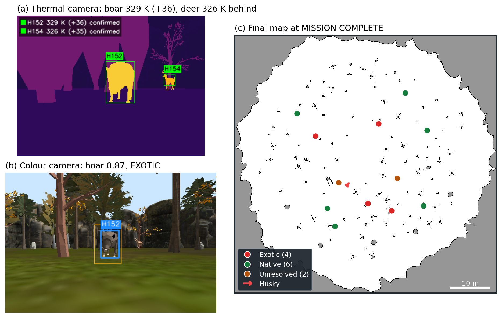

# Wild Track: Autonomous Exotic Animal Survey

**41068 Robotics Studio 1, Group 9**

A Husky ground robot explores a simulated forest on its own, finds warm bodies with a thermal camera, and identifies exotic boars and native deer and kangaroos with a YOLO model on its colour camera. Each heat source is placed on the map, and anything the robot cannot confirm is kept as "unresolved" with a reason, for a ranger to check. When exploration ends, the robot looks at any area the thermal camera has not yet seen and returns to its start point.

The system runs in Ignition Gazebo Fortress with ROS 2 Humble: SLAM Toolbox and Nav2 for mapping and navigation, frontier exploration, thermal and RGB perception, depth-based localisation, a mission state machine and an operator GUI. Gazebo ground truth is used only for evaluation.

<!-- Figure: replace the line below with the summary image -->


*(a) Thermal detection, (b) YOLO verification of a boar, (c) final map at MISSION COMPLETE.*

## Videos

| | Scenario | Link |
|---|---|---|
| V1 | Full mission, world layout | [youtu.be/oBOc9h9AF5E](https://youtu.be/oBOc9h9AF5E) |
| V2 | Random layout (seed 11) | [youtu.be/zoj7yju-3_s](https://youtu.be/zoj7yju-3_s) |
| V3 | Animals next to trees (seed 21, cover) | [youtu.be/_3ewNtgGpY0](https://youtu.be/_3ewNtgGpY0) |
| V4 | Live demo events: obstacle, unreachable target | [youtu.be/j6AfcFBTrK0](https://youtu.be/j6AfcFBTrK0) |

## Results

18 missions on fixed, random and tree-occluded layouts (2 November 2026, 14 heat sources per mission):

| Metric | Result |
|---|---|
| Boars confirmed exotic | 87 / 90 (97%) |
| Heat sources found | 244 / 252 (96.8%), no false alarms |
| Mean position error | 0.30 m (243 / 244 within 1 m) |
| Missions completed / returned home | 18 / 18, 17 / 18 |

Tables, confusion matrix and figures: [`docs/evaluation/2026-11-02/`](docs/evaluation/2026-11-02/).

## Installation

Ubuntu 22.04, ROS 2 Humble and Ignition Gazebo Fortress (`ign gazebo --versions` should report 6).

```bash
sudo apt install -y git-lfs python3-colcon-common-extensions python3-rosdep \
  ros-humble-ros-ign ros-humble-navigation2 ros-humble-nav2-bringup \
  ros-humble-nav2-rotation-shim-controller ros-humble-slam-toolbox \
  ros-humble-robot-localization ros-humble-vision-msgs ros-humble-cv-bridge
```

Clone into a workspace and build:

```bash
mkdir -p ~/41068_ws/src && cd ~/41068_ws/src
git lfs install
git clone https://github.com/honglinhnguyen-alt/Robotic_Studio1.git
cd ~/41068_ws
rosdep install --from-paths src --ignore-src --rosdistro humble -r -y
/usr/bin/python3 -m pip install --user "numpy<2" "opencv-python<4.12" ultralytics
source /opt/ros/humble/setup.bash
colcon build --symlink-install --packages-up-to 41068_ignition_bringup wildlife_gui explore_lite
```

## Run a mission

In every terminal:

```bash
source /opt/ros/humble/setup.bash
source ~/41068_ws/install/setup.bash
export ROS_LOCALHOST_ONLY=1
```

| Command | What it runs |
|---|---|
| `ros2 launch 41068_ignition_bringup 41068_demo.launch.py` | New random animal layout every launch |
| `ros2 launch 41068_ignition_bringup 41068_demo.launch.py seed:=world` | Fixed layout from the world file |
| `ros2 launch 41068_ignition_bringup 41068_demo.launch.py seed:=21 profile:=cover` | Reproducible layout with every animal next to a tree |

Add `rviz:=false` to keep RViz closed; the operator GUI opens on its own. A mission takes about 15–22 minutes and needs no input. Results are written to `~/wildtrack_runs/`.

Live demo events, from a second terminal while a mission runs:

```bash
ros2 run 41068_ignition_bringup demo_events.py heat         # campfire appears ahead
ros2 run 41068_ignition_bringup demo_events.py obstacle     # box dropped ahead
ros2 run 41068_ignition_bringup demo_events.py unreachable  # candidate outside the map
```

## Repository structure

| Folder | Contents |
|---|---|
| `41068_ignition_bringup/` | Worlds, robot model, launch files, perception, mission, navigation and evaluation scripts, YOLO weights |
| `wildlife_spatial/` | Candidate localisation, registry and ground-truth evaluator |
| `wildlife_gui/` | Operator GUI (PyQt5) |
| `m-explore-ros2/` | Adapted frontier exploration (explore_lite) |
| `docs/evaluation/` | Evaluation batches: CSV files, tables and figures |

## Team

| Member | ID | Lead area |
|---|---|---|
| Nhat Thien Mai | 25161391 | Perception: thermal detection and YOLO |
| Hong Linh Nguyen | 25761646 | Localisation, registry and evaluation |
| Phu Trung Nguyen | 25157241 | Navigation and observation poses |
| Chia-Ying Yang | 14429043 | Mission logic, coverage and integration |
| Nhat Minh Vu | 25761610 | Simulation world and operator GUI |
