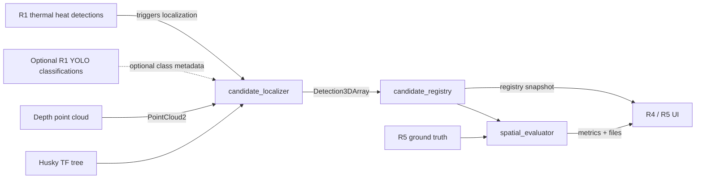

# Wildlife Spatial

`wildlife_spatial` is the ROS 2 Humble package for the R2 **Candidate
Localization and Evaluation** role. It turns an R1 thermal heat detection into
a map position, remembers physical candidates without repeatedly counting the
same heat source, and compares the results with R5 simulation ground truth.
Localization does not depend on YOLO recognizing an animal. YOLO
classification is optional metadata that can be added to an already localized
candidate.

The package contains three executable nodes:

| Executable | Purpose |
|---|---|
| `candidate_localizer` | Projects a thermal heat box into the depth image, then combines it with the point cloud and TF to estimate a 3D position in `husky1_map`. |
| `candidate_registry` | Assigns stable candidate IDs and merges repeated observations using map distance. |
| `spatial_evaluator` | Compares registry estimates with ground truth and writes metrics to CSV and JSON. |

R2 is responsible for storing candidate state information supplied by R4. R2
does not decide which candidate to investigate or change a candidate's mission
state. The current registry publishes `uninvestigated` as its initial state;
the R4-to-R2 state-update interface is still to be integrated.

## Data flow



## How the nodes work

### 1. Candidate localizer

The localizer subscribes to R1's raw thermal detections, optional fused
thermal/YOLO detections, and the organized RGB-D point cloud. Only a message on
`/husky1/perception/thermal/detections` can trigger localization. A YOLO message
is cached as optional class metadata and never starts localization by itself.

For each thermal heat detection it:

1. Finds the buffered point cloud with the nearest timestamp.
2. Rejects the detection if the time difference is greater than `0.5 s` by
   default.
3. Projects the 320x240 thermal bounding box into the 720x480 RGB-D image using
   the cameras' fields of view. A configurable margin allows for the small
   difference between the thermal and RGB camera positions.
4. Samples XYZ points from the inner part of the projected box. Using the
   inner region reduces background points near the box edges.
5. Removes NaN, infinite, too-near, and too-far samples.
6. Uses the coordinate-wise median as a robust camera-frame position.
7. Looks up the timestamped transform from `husky1_camera_link` to
   `husky1_map`.
8. Publishes the map point, a debug marker, and a localized
   `Detection3DArray` for the registry.

If no fresh YOLO result exists, the output class is
`unknown_heat_source` with confidence `0.0`. The candidate is still localized,
published, and stored in the registry. If YOLO later recognizes it, a later
thermal observation can upgrade the same nearby registry record to the animal
class.

The median spread of the valid depth samples is also calculated. It controls
the size of the debug sphere and indicates how dispersed the sampled surface
points are.

#### Localizer interfaces

| Direction | Topic | Message type | Meaning |
|---|---|---|---|
| Input, trigger | `/husky1/perception/thermal/detections` | `vision_msgs/msg/Detection2DArray` | Raw heat-source boxes; each nonempty message starts localization. |
| Input, optional | `/husky1/perception/thermal_yolo/detections` | `vision_msgs/msg/Detection2DArray` | YOLO classes cached for active thermal candidates; does not trigger localization. |
| Input | `/husky1/camera/depth/points` | `sensor_msgs/msg/PointCloud2` | Organized point cloud aligned with the RGB image. |
| Input | `/husky1/tf`, `/husky1/tf_static` | TF messages | Transform from the camera to the map. |
| Output | `/husky1/candidates/localized_point` | `geometry_msgs/msg/PointStamped` | Individual map-frame position, useful for debugging. |
| Output | `/husky1/candidates/localized_detections` | `vision_msgs/msg/Detection3DArray` | Map position plus the R1 class and confidence. |
| Output | `/husky1/candidates/marker` | `visualization_msgs/msg/Marker` | Orange temporary localization marker. |

#### Localizer parameters

| Parameter | Default | Meaning |
|---|---:|---|
| `detection_topic` | `/husky1/perception/thermal/detections` | Raw thermal input that triggers localization. |
| `classification_topic` | `/husky1/perception/thermal_yolo/detections` | Optional YOLO class input. |
| `point_cloud_topic` | `/husky1/camera/depth/points` | Organized depth cloud input. |
| `cloud_buffer_seconds` | `5.0` | Amount of point-cloud history retained. |
| `max_cloud_time_difference` | `0.5` | Maximum accepted detection/cloud time difference in seconds. |
| `bbox_inner_fraction` | `0.5` | Fraction of the centre of the box used for depth sampling. |
| `pixel_stride` | `2` | Sample every Nth point-cloud pixel. |
| `minimum_range` | `0.2` | Minimum accepted point range in metres. |
| `maximum_range` | `20.0` | Maximum accepted point range in metres. |
| `minimum_valid_points` | `20` | Samples required to produce an estimate. |
| `thermal_image_width` | `320` | Thermal image width used for projection. |
| `thermal_image_height` | `240` | Thermal image height used for projection. |
| `thermal_hfov_deg` | `60.0` | Thermal camera horizontal field of view. |
| `depth_hfov_deg` | `120.0` | RGB-D camera horizontal field of view. |
| `thermal_projection_margin` | `1.5` | Scale applied to the projected box before depth sampling. |
| `thermal_depth_offset_x_px` | `0.0` | Optional horizontal projection calibration in depth pixels. |
| `thermal_depth_offset_y_px` | `0.0` | Optional vertical projection calibration in depth pixels. |
| `classification_max_age` | `10.0` | Maximum age in seconds of cached YOLO metadata. |
| `map_frame` | `husky1_map` | Output coordinate frame. |
| `localized_point_topic` | `/husky1/candidates/localized_point` | Debug point output. |
| `localized_detections_topic` | `/husky1/candidates/localized_detections` | Registry input. |
| `marker_topic` | `/husky1/candidates/marker` | Temporary RViz marker output. |
| `transform_timeout` | `0.25` | TF lookup timeout in seconds. |

### 2. Candidate registry

The registry keeps one record for each estimated physical animal. When a
localized observation arrives, it finds the nearest stored candidate using XY
map distance.

- If the nearest candidate is within `merge_distance`, the observation is
  merged into that record.
- Otherwise, the registry creates `candidate_1`, `candidate_2`, and so on.
- A merged record uses a running average of all observed XYZ positions.
- An animal class replaces `unknown_heat_source` when one becomes available.
- A later unknown observation cannot erase a known animal class. Between two
  animal classes, the higher-confidence classification is retained.
- The record stores its source IDs, first and last timestamps, and observation
  count.

The registry uses planar distance because R3 navigation targets are defined on
the ground plane and the detected body height can vary.

#### Registry interfaces

| Direction | Topic | Message type | Meaning |
|---|---|---|---|
| Input | `/husky1/candidates/localized_detections` | `vision_msgs/msg/Detection3DArray` | Localized R1 observations. |
| Output | `/husky1/candidates/registry` | `vision_msgs/msg/Detection3DArray` | Complete current candidate snapshot. |
| Output | `/husky1/candidates/registry_json` | `std_msgs/msg/String` | JSON snapshot for R4 and the UI. |
| Output | `/husky1/candidates/registry_markers` | `visualization_msgs/msg/MarkerArray` | Persistent cyan spheres and text labels for RViz. |

#### Registry parameters

| Parameter | Default | Meaning |
|---|---:|---|
| `input_topic` | `/husky1/candidates/localized_detections` | Localizer input. |
| `registry_topic` | `/husky1/candidates/registry` | ROS registry snapshot. |
| `registry_json_topic` | `/husky1/candidates/registry_json` | JSON registry snapshot. |
| `marker_topic` | `/husky1/candidates/registry_markers` | RViz MarkerArray output. |
| `map_frame` | `husky1_map` | Required coordinate frame. |
| `merge_distance` | `1.0` | Maximum XY separation in metres for duplicate merging. |
| `marker_diameter` | `0.5` | Registry sphere diameter in metres. |

The registry is currently stored in memory. Restarting the registry node clears
its records and the first new observation becomes `candidate_1` again. Keep
the node running for the complete mission.

### 3. Spatial evaluator

The evaluator compares the latest registry snapshot with R5 ground truth. It
creates unique nearest estimate/truth pairs inside
`maximum_match_distance`, then calculates:

- matched, false-positive, and missed counts;
- precision and recall;
- mean, median, RMSE, and maximum planar localization error;
- mean 3D error; and
- classification accuracy for matched candidates.

Planar error is the main localization measurement. An animal model's ground
truth Z coordinate is normally its ground contact or model origin, while the
depth estimate often lies on the visible body surface.

#### Evaluator interfaces

| Direction | Topic | Message type | Meaning |
|---|---|---|---|
| Input | `/husky1/candidates/registry` | `vision_msgs/msg/Detection3DArray` | Estimated candidates. |
| Input | `/simulation/ground_truth/animals` | `vision_msgs/msg/Detection3DArray` | Live R5 ground truth, when available. |
| Output | `/husky1/evaluation/summary` | `std_msgs/msg/String` | Latest metrics as JSON. |

The evaluator can also load ground truth from a JSON file
(`ground_truth_file`) or straight from an SDF world (`ground_truth_world`).
From a world it keeps every `<include>` of a heat-source model: boar,
male/female deer (class `deer`), kangaroo and campfire. Poses are used as
map coordinates because the Husky spawns at the world origin with zero yaw.
`41068_mission.launch.py` starts the evaluator with
`worlds/<world>.sdf`, so `world:=` must match the simulation.

`config/static_large_demo_ground_truth.json` is generated from
`large_demo.sdf` (5 boars, 4 deer, 3 kangaroos, 2 campfires);
`test_static_ground_truth_matches_large_demo_world` fails when the two
drift apart. Neither source is valid after the animals have been moved by
`random_animal_spawn.py`.

A campfire counts as correctly classified when its estimate carries no
animal label (for example `unknown_heat_source`). The summary also reports
`within_tolerance_count` (R7, planar error <= `localization_tolerance`) and
`per_class` detection/classification recall; `per_class.boar` is the R10
figure.

#### Evaluator parameters

| Parameter | Default | Meaning |
|---|---:|---|
| `registry_topic` | `/husky1/candidates/registry` | Registry input. |
| `ground_truth_topic` | `/simulation/ground_truth/animals` | Live R5 truth input. |
| `summary_topic` | `/husky1/evaluation/summary` | JSON metric output. |
| `ground_truth_file` | empty | Optional static truth JSON file. |
| `ground_truth_world` | empty | SDF world used when `ground_truth_file` is empty. |
| `map_frame` | `husky1_map` | Required estimate and truth frame. |
| `maximum_match_distance` | `2.0` | Maximum XY distance for estimate/truth matching. |
| `localization_tolerance` | `1.0` | R7 planar error limit for `within_tolerance_count`. |
| `non_animal_classes` | `[campfire]` | Truth classes that must not get an animal label. |
| `output_directory` | `~/wildlife_evaluation_logs` | Parent directory for run logs. |

Each evaluator process creates a directory similar to:

```text
~/wildlife_evaluation_logs/run_20260913_173345_12345/
├── evaluation.csv
└── summary.json
```

`evaluation.csv` contains one row per matched, false-positive, or missed object
for every registry update. `summary.json` contains the newest aggregate
metrics.

## Build the package

The repository package is expected to be present under `~/ros2_ws/src`, either
as a directory or a symbolic link. Run all build commands in `~/ros2_ws`:

```bash
cd ~/ros2_ws
source /opt/ros/humble/setup.bash

colcon build --symlink-install --packages-select wildlife_spatial

source ~/ros2_ws/install/setup.bash
ros2 pkg executables wildlife_spatial
```

Expected executables:

```text
wildlife_spatial candidate_localizer
wildlife_spatial candidate_registry
wildlife_spatial spatial_evaluator
```

Source the ROS installation and this workspace in every new terminal:

```bash
source /opt/ros/humble/setup.bash
source ~/ros2_ws/install/setup.bash
export ROS_LOCALHOST_ONLY=1
```

All terminals in one experiment must use the same `ROS_LOCALHOST_ONLY` and
`ROS_DOMAIN_ID` settings.

## Run the complete pipeline

The following procedure starts from a clean set of terminals. Commands are
shown separately because each long-running process must remain active.

### Terminal 1: Gazebo, Husky, SLAM, Nav2, and RViz

```bash
cd ~/ros2_ws
source /opt/ros/humble/setup.bash
source ~/ros2_ws/install/setup.bash
export ROS_LOCALHOST_ONLY=1

ros2 launch 41068_ignition_bringup \
  41068_ignition_husky.launch.py \
  slam:=true \
  nav2:=true \
  rviz:=true \
  world:=large_demo
```

Wait until Gazebo, the sensor bridges, SLAM, Nav2, and RViz have loaded.

### Terminal 2: R1 thermal and YOLO perception

```bash
cd ~/ros2_ws
source /opt/ros/humble/setup.bash
source ~/ros2_ws/install/setup.bash
export ROS_LOCALHOST_ONLY=1

ros2 launch 41068_ignition_bringup \
  41068_thermal_yolo.launch.py \
  namespace:=husky1 \
  thermal_retrigger_sec:=5.0
```

The positive retrigger interval allows the same visible heat region to be
classified repeatedly, which is useful while testing localization and merging.

### Terminal 3: R2 candidate localizer

```bash
cd ~/ros2_ws
source /opt/ros/humble/setup.bash
source ~/ros2_ws/install/setup.bash
export ROS_LOCALHOST_ONLY=1

ros2 run wildlife_spatial candidate_localizer \
  --ros-args \
  -p use_sim_time:=true \
  -r /tf:=/husky1/tf \
  -r /tf_static:=/husky1/tf_static
```

The TF remappings are required because this simulation publishes the Husky TF
tree on `/husky1/tf` and `/husky1/tf_static`.

A successful estimate without a YOLO classification looks like:

```text
Projected thermal_1 into depth image: ... class=unknown_heat_source 0.00
Camera-frame estimate for thermal_1: position=(2.712, -0.278, 0.309) m ...
Map-frame estimate for thermal_1: position=(4.024, 6.909, 0.559) m, frame=husky1_map
```

### Terminal 4: R2 candidate registry

Start this node once and leave it running for the full mission:

```bash
cd ~/ros2_ws
source /opt/ros/humble/setup.bash
source ~/ros2_ws/install/setup.bash
export ROS_LOCALHOST_ONLY=1

ros2 run wildlife_spatial candidate_registry \
  --ros-args \
  -p use_sim_time:=true \
  -p merge_distance:=1.0
```

Expected output when thermal localization succeeds before YOLO:

```text
Created candidate_1 at (4.024, 6.909, 0.559) m; class=unknown_heat_source 0.00
Merged observation into candidate_1: distance=0.000 m, observations=2, class=kangaroo 0.92
```

### Terminal 5: R2 spatial evaluator

For the original, non-randomized `large_demo` animal positions:

```bash
cd ~/ros2_ws
source /opt/ros/humble/setup.bash
source ~/ros2_ws/install/setup.bash
export ROS_LOCALHOST_ONLY=1

ros2 run wildlife_spatial spatial_evaluator \
  --ros-args \
  -p use_sim_time:=true \
  -p ground_truth_file:=/home/tony/ros2_ws/install/wildlife_spatial/share/wildlife_spatial/config/static_large_demo_ground_truth.json
```

With only the default kangaroo observed, a reasonable result is:

```text
Evaluation 1: matched=1/14, mean planar error=0.094 m, within 1.0 m=1, class accuracy=100.0%, boars confirmed=0/5
```

`matched=1/4` is correct until the Husky observes the other three animals.

### Terminal 6: keyboard control

```bash
cd ~/ros2_ws
source /opt/ros/humble/setup.bash
source ~/ros2_ws/install/setup.bash
export ROS_LOCALHOST_ONLY=1

ros2 run teleop_twist_keyboard teleop_twist_keyboard \
  --ros-args \
  -r cmd_vel:=/husky1/cmd_vel
```

Keep Terminals 3 and 4 running while driving from one animal to another.

## Test each node

### Check required upstream data

Run these checks in a separate sourced terminal while Gazebo and R1 are
running:

```bash
ros2 topic type /husky1/camera/depth/points
ros2 topic echo /husky1/camera/depth/points --once --no-arr
ros2 topic echo /husky1/perception/thermal/detections --once --no-arr
ros2 topic echo /husky1/perception/thermal_yolo/detections --once --no-arr

ros2 run tf2_ros tf2_echo \
  husky1_map \
  husky1_camera_link \
  --ros-args \
  -r /tf:=/husky1/tf \
  -r /tf_static:=/husky1/tf_static
```

The point cloud should be `sensor_msgs/msg/PointCloud2`, organized with a
non-zero width and height, and contain `x`, `y`, and `z` fields. Stop
`tf2_echo` with `Ctrl+C` after transforms appear.

### Test map localization

```bash
ros2 topic echo /husky1/candidates/localized_point --once
```

Pass conditions:

- `header.frame_id` is `husky1_map`;
- X, Y, and Z are finite numbers;
- repeated observations of a stationary animal stay near the same position;
- the orange marker appears at the animal in RViz.

### Test duplicate merging

Inspect the registry:

```bash
ros2 topic echo /husky1/candidates/registry_json \
  --field data \
  --full-length \
  --qos-durability transient_local \
  --once
```

For repeated views of the same stationary animal:

- `candidate_count` remains `1`;
- `candidate_id` remains `candidate_1`; and
- `observation_count` increases.

Drive to another animal while the registry remains running. If its localized
position is more than `1.0 m` from the first candidate, the registry should log
`Created candidate_2`, and `candidate_count` should become `2`.

### Test RViz registry markers

In RViz:

1. Set **Fixed Frame** to `husky1_map`.
2. Select **Add** and choose **MarkerArray**.
3. Set the topic to `/husky1/candidates/registry_markers`.

The cyan spheres and labels represent stored registry candidates. The orange
`/husky1/candidates/marker` display is only the current localizer debug marker.
R1 can reuse the source ID `thermal_1`, so that orange marker can move to the
newest animal. Use the cyan MarkerArray when checking registry retention.

### Test evaluation metrics

```bash
ros2 topic echo /husky1/evaluation/summary \
  --field data \
  --full-length \
  --qos-durability transient_local \
  --once
```

For the default kangaroo at `(4.0, 7.0)`, the previously measured estimate
`(4.024, 6.909)` has about `0.094 m` planar error. Check the evaluator terminal
for the actual log directory, then inspect its files:

```bash
cat ~/wildlife_evaluation_logs/run_<date>_<time>_<pid>/summary.json
column -s, -t ~/wildlife_evaluation_logs/run_<date>_<time>_<pid>/evaluation.csv | less -S
```

Replace `<date>`, `<time>`, and `<pid>` with the directory printed by the node.

### Run automated tests

Run from the ROS workspace:

```bash
cd ~/ros2_ws
source /opt/ros/humble/setup.bash

colcon test --packages-select wildlife_spatial
colcon test-result --verbose
```

To run the functional Python tests directly from the repository:

```bash
cd ~/git/Robotic_Studio1/wildlife_spatial
source /opt/ros/humble/setup.bash

python3 -m pytest -q \
  test/test_time_matching.py \
  test/test_depth_extraction.py \
  test/test_candidate_registry.py \
  test/test_spatial_evaluator.py
```

The functional suite currently contains 21 tests.

## Ground-truth JSON format

R5 can provide repeatable ground truth using this format:

```json
{
  "frame_id": "husky1_map",
  "objects": [
    {
      "id": "kangaroo1",
      "class_name": "kangaroo",
      "position": {"x": 4.0, "y": 7.0, "z": 0.0}
    }
  ]
}
```

For randomized or moving animals, R5 should publish a
`vision_msgs/msg/Detection3DArray` on
`/simulation/ground_truth/animals`. Every detection needs:

- `header.frame_id: husky1_map`;
- the simulation object ID in `id`;
- the class in `results[0].hypothesis.class_id`; and
- the actual XYZ position in `bbox.center.position`.

## Common warnings and fixes

### Closest point cloud exceeds the time limit

```text
Cannot localize detection: closest point cloud differs by ...
```

The localizer intentionally rejects a stale cloud. A later synchronized
detection should succeed. Check that Gazebo is running and every node uses
`use_sim_time:=true`.

### TF extrapolation into the future

```text
Lookup would require extrapolation into the future
```

The point cloud arrived ahead of the newest transform. That observation is
rejected; later synchronized observations normally recover. Confirm the two TF
remappings are present on the localizer command.

### Frame does not exist

Use the exact frame names without leading slashes:

```text
husky1_map
husky1_camera_link
```

Then verify them with the `tf2_echo` command above.

### Registry starts again at candidate_1

The registry currently uses memory-only storage. Restarting it creates a new
empty mission registry. Start it before the first animal and leave it running.

### Previous marker disappears when a new animal is seen

The orange localizer marker follows R1's source detection ID, which may be
reused. Display `/husky1/candidates/registry_markers` as a **MarkerArray** to
see all stored candidates.

### Package not found

Rebuild and source the workspace in the same terminal:

```bash
cd ~/ros2_ws
source /opt/ros/humble/setup.bash
colcon build --symlink-install --packages-select wildlife_spatial
source ~/ros2_ws/install/setup.bash
ros2 pkg prefix wildlife_spatial
```

### NumPy and cv_bridge incompatibility

ROS 2 Humble's installed `cv_bridge` must use a compatible NumPy version. If
the perception launch reports that a module compiled for NumPy 1.x cannot run
with NumPy 2.x, restore the working Python environment before testing R2. This
error originates in the full R1 image pipeline rather than the spatial
localization algorithms.

## Package layout

```text
wildlife_spatial/
├── config/
│   └── static_large_demo_ground_truth.json
├── resource/
│   └── wildlife_spatial
├── test/
│   ├── test_candidate_registry.py
│   ├── test_depth_extraction.py
│   ├── test_spatial_evaluator.py
│   └── test_time_matching.py
├── wildlife_spatial/
│   ├── __init__.py
│   ├── candidate_localizer.py
│   ├── candidate_registry.py
│   └── spatial_evaluator.py
├── package.xml
├── setup.cfg
└── setup.py
```
